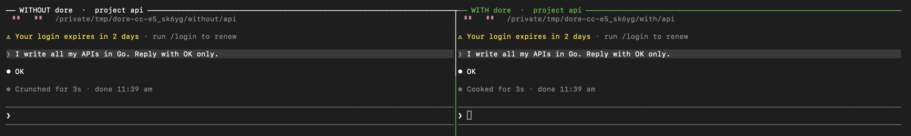

<h1 align="center">dore</h1>

<p align="center">
  <strong>Memory for Claude Code. Say it once, it remembers in every new session.</strong><br/>
  Runs on your laptop · free to learn · nothing leaves your machine
</p>

<p align="center">
  
  
  
  
</p>

## The problem

Every new Claude Code session forgets what you told it before.

- You repeat the same things: your server port, your database, "don't reformat my code".
- When something changes, old information can come back.
- Writing it all into `CLAUDE.md` by hand is extra work.

## The solution

dore listens to what you type and remembers the important parts.

- **Nothing to learn:** just talk to Claude Code as usual.
- **Stays up to date:** when you say something new, it replaces the old note.
- **Cheap and fast:** learning costs 0 Claude tokens. Most prompts get nothing added (0 tokens).
  Each prompt takes about 13 ms.

## See it work in Claude Code

Real screenshots: two Claude Code windows side by side, left **without** dore, right **with** dore.
Claude Code's own memory is turned off on both sides, so only dore can remember.

**Session 1:** tell Claude a fact.


**Session 2:** close Claude, start a new session, and ask.


Without dore, Claude can't find the port. With dore, it answers **8443** right away.

### Shared across projects

Facts about you are shared by all your projects. Tell it in project **api**:



Then ask in a different project, **shop**:


Without dore, Claude can't tell. With dore, it knows: **Go**. Facts about one project (like its port) stay in
that project.

## Test results

| Test | Result |
|---|---|
| Remembers facts across 20 sessions | **80 of 80** |
| Shows an outdated value after a change | **0 of 53** |
| Saves chatter (requests, questions) by mistake | **0 of 39** |
| Correct after 24 weeks, 12 projects | **81%** |
| Time per prompt | **13 ms** |

Run them yourself (no AI model needed, a few seconds each):

```bash
.venv/bin/pytest -q
.venv/bin/python -m dore.eval.conversation
.venv/bin/python -m dore.eval.learning
```

## Install

```bash
cd ~/Documents/dore                     # or set DORE_HOME to where it is
uv venv .venv --python 3.12
uv pip install --python .venv/bin/python -e ".[dev]"
claude plugin marketplace add ~/Documents/dore
claude plugin install dore@dore
```

Then use Claude Code as usual. Works on macOS and Linux, no GPU. It also works with opencode and other MCP agents.

## Limits

- One question per fact works best. If one question asks two things, it may answer only one.
- Different words for the same thing ("job" vs "work as a nurse") may not match.
- English only.

## More

[`AGENTS.md`](AGENTS.md) (design and roadmap) · [`.agents/rules/`](.agents/rules) (details and all measurements) ·
[`REFERENCES.md`](REFERENCES.md) (where the ideas come from)

## License

[MIT](LICENSE): free to use, change and share.
