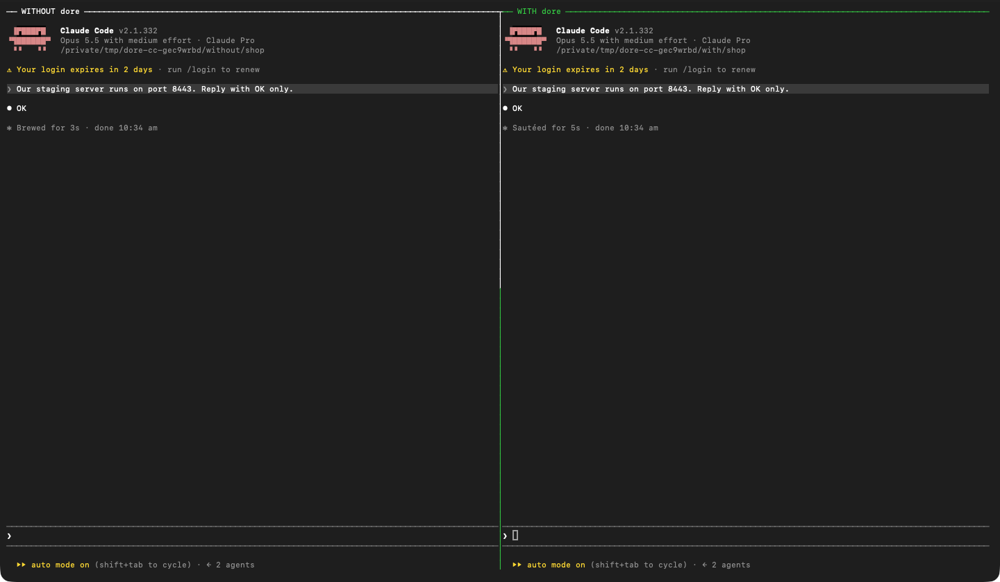
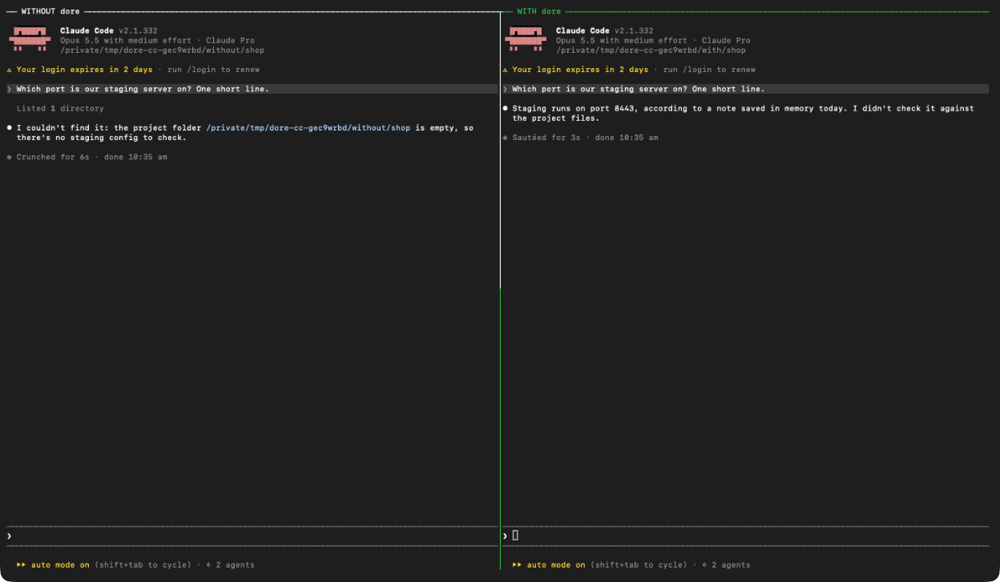
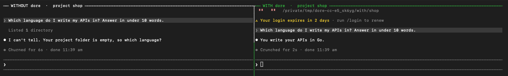

<h1 align="center">dore</h1>

<p align="center">
  <strong>Memory for Claude Code. Say it once, it remembers in every new session.</strong><br/>
  Runs on your laptop · free to learn · nothing leaves your machine
</p>

<p align="center">
  
  <a href="https://github.com/SopheaII/dore-memory/actions/workflows/ci.yml"></a>
  <a href="https://www.npmjs.com/package/dore-memory"></a>
  
  
  
</p>

```bash
npx dore-memory install     # sets up dore and its Claude Code plugin, then open a new Claude Code session
```

## Why dore

**Problem:** Claude Code forgets everything when you start a new session, so you explain the same things again and again.

**Solution:** dore gives Claude a memory that works like yours:

- 👂 **It listens.** When you tell Claude a fact ("our staging server uses port 8443"), dore saves it.
  You don't need to say "remember this".
- 💡 **It reminds.** When you ask about it later, even in a new session, dore hands Claude that note before it answers.
- 🔄 **It updates.** When a fact changes ("the staging port is now 9443"), the new fact replaces the old one.
- 🗂️ **It keeps things in place.** Facts about you (your name, how you like to work) are used in every project.
  Facts about one project (its port, its database) stay in that project.

## How is it different from other memory tools?

Most memory tools let the AI manage the memory: the AI decides what to save, and then either loads the whole
memory into every message or has to search it. That costs tokens, and if the AI forgets to save, the fact is lost.

dore manages the memory itself, outside the AI:

| | Usual memory tools | dore |
|---|---|---|
| Who decides what to save | The AI (costs tokens, and it can forget) | dore, from what you type (free, every time) |
| What Claude receives | The whole memory, or what the AI searched for | Only the notes that match your message (usually none) |
| When a fact changes | Old and new notes may both stay | The old note is replaced |
| When notes disagree | No rule | What you said wins over what the AI guessed |
| Where it runs | Sometimes a cloud service | Only on your computer |

Learning costs 0 Claude tokens and adds about 13 ms to each message.

## See it work in Claude Code

Left: **without** dore. Right: **with** dore.

**Session 1:** tell Claude a fact.



**Session 2:** close Claude, start a new session, and ask.



Without dore, Claude can't find the port. With dore, it answers **8443** right away.

### Shared across projects

Facts about you are shared by all your projects. Tell it in project **api**:


Then ask in a different project, **shop**:



Without dore, Claude can't tell. With dore, it knows: **Go**. Facts about one project (like its port) stay in
that project.

## Test results

| Test | Result |
|---|---|
| Remembers facts across 20 sessions | **80 of 80** |
| Shows an outdated value after a change | **0 of 53** |
| Saves chatter (requests, questions) by mistake | **0 of 39** |
| Correct after 24 weeks, 12 projects | **81%** |
| Time per prompt | **13 ms** |

Run them yourself (no AI model needed, a few seconds each):

```bash
.venv/bin/pytest -q
.venv/bin/python -m dore.eval.conversation
.venv/bin/python -m dore.eval.learning
```

## Install

### With npm (recommended)

Needs Node 18+, [Claude Code](https://claude.com/claude-code), and [uv](https://docs.astral.sh/uv/) or Python 3.11+.

```bash
npx dore-memory install
```

Then start a new Claude Code session and talk as usual. That's it.

| Command | What it does |
|---|---|
| `npx dore-memory install` | Sets up dore and turns on its Claude Code plugin |
| `npx dore-memory status` | Shows where dore is and whether the plugin is on |
| `npx dore-memory update` | Gets the latest dore |
| `npx dore-memory uninstall` | Removes dore and the plugin (your memory is kept) |

**What `install` does:** sets up dore in `~/.dore-memory` and turns on its Claude Code plugin.
Your memory is saved in `~/.dore-memory/data`. Change the folder with `DORE_HOME`.
The first install downloads about 200 MB (Python packages and a small search model).

### From source

```bash
git clone https://github.com/SopheaII/dore-memory.git ~/Documents/dore
cd ~/Documents/dore                     # or set DORE_HOME to where it is
uv venv .venv --python 3.12
uv pip install --python .venv/bin/python -e ".[dev]"
claude plugin marketplace add ~/Documents/dore
claude plugin install dore-memory@dore-memory
```

Works on macOS, Linux and Windows (Claude Code on Windows uses Git Bash, which dore's hooks need), no GPU.
It also works with opencode and other MCP agents.

## How it works

1. **You type a message** in Claude Code. dore's hook reads it before Claude does.
2. **If it tells a fact** ("our staging port is 8443"), dore saves it as a note on your machine.
   Questions and requests are not saved.
3. **If it asks about something dore knows**, the hook adds the matching notes (a few lines) to your
   message, so Claude can answer. If nothing matches, nothing is added (0 tokens).
4. **If a fact changes** ("the port is now 9443"), the newer note replaces the old one.

Learning runs locally with small models, so it costs no Claude tokens and nothing leaves your machine.

## Limits

- One question per fact works best. If one question asks two things, it may answer only one.
- Different words for the same thing ("job" vs "work as a nurse") may not match.
- English only.

## More

[`AGENTS.md`](AGENTS.md) (design and roadmap) · [`.agents/rules/`](.agents/rules) (details and all measurements) ·
[`REFERENCES.md`](REFERENCES.md) (where the ideas come from)

## License

[MIT](LICENSE): free to use, change and share.
